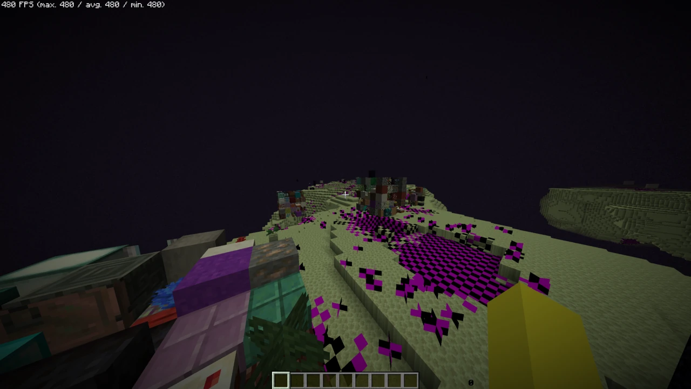
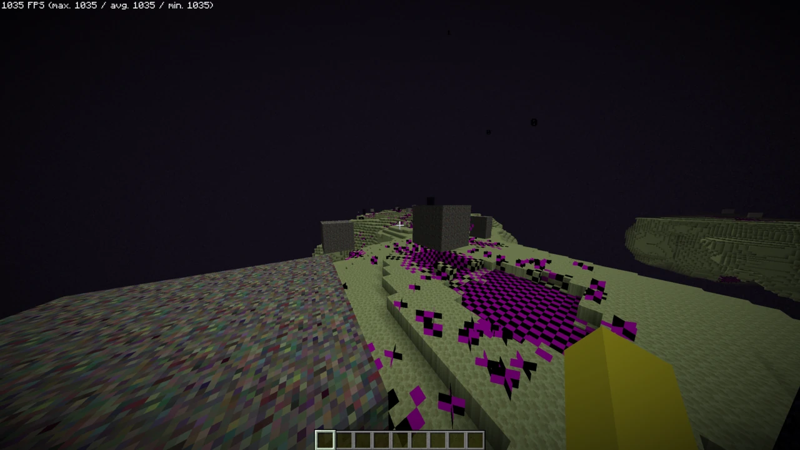

# Biomes Were Already Plenty

Client-side Fabric mod that stops the Anomaly block from Biomes O' Plenty flickering and tanking your FPS.

> Available for 1.20.1, 1.21 to 1.21.11 and 26.1.2 to 26.3. No 1.21.2, 26.1 or 26.1.1 version since Biomes O' Plenty has no Fabric release for them

## Before / After

| Before | After |
|--------|-------|
|  |  |

## What it does

The Anomaly block rapidly cycles through random block textures when you get close to it, which tanks your FPS. This mod
makes it show its own texture instead.

## Config

Via Mod Menu or `.minecraft/config/biomes-were-already-plenty.json`

| Option                       | Default | Description                                            |
|------------------------------|---------|--------------------------------------------------------|
| Fix Anomaly Block Flickering | true    | Stops the block cycling through random block states    |
| Freeze Anomaly Texture       | false   | Freezes the texture on the first frame (requires F3+T) |

## Dependencies

- [Fabric Loader](https://fabricmc.net)
- [Fabric API](https://modrinth.com/mod/fabric-api)
- [Cloth Config](https://modrinth.com/mod/cloth-config)
- [Mod Menu](https://modrinth.com/mod/modmenu) (optional)

## Building

Builds without any extra steps. BOP and Mod Menu are pulled in automatically for IDE support and for testing with
`./gradlew :1.21.1:runClient`, so no more evil red texts.

## License

[GPL-3.0](LICENSE)
